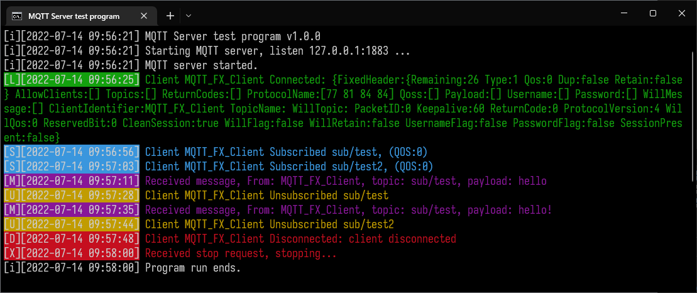
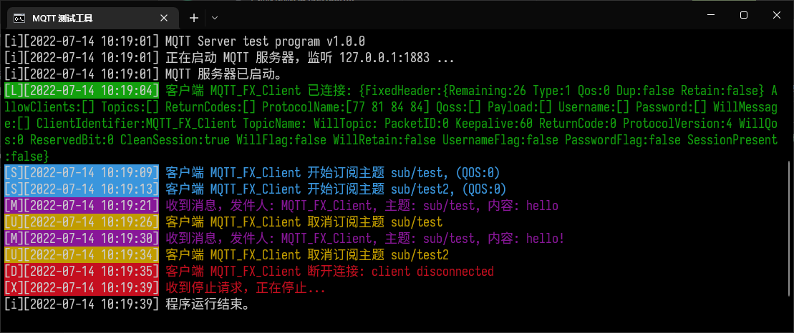

# [MQTT Device Testing Tool](https://github.com/tongdysoft/mqtt-test-server)

[ English | [中文](#mqtt-客户端测试工具)]

This tool can help you test the stability of your device's MQTT connection.

- version: `1.5.5`
- golang version: `1.21`

## Function

- Display and log data and behavior of MQTT devices.

## Install

Download the program from [Release](releases). No installation required.

Non-Windows systems need to use `chmod +x <executable file name>` to add permission to run.

### Docker

- You can refer to and modify `Dockerfile` and `docker.sh` files to create Docker images and containers.
- Deployment is relative to the compiled file, run on alpine, does not include compilation of source code.

### Linux systemd

1. Copy `MQTTDeviceTestingTool.service` to `/etc/systemd/system/`
2. Modify the path and start user in `/etc/systemd/system/MQTTDeviceTestingTool.service`
3. `sudo systemctl start MQTTDeviceTestingTool.service`

### Linux desktop shortcuts

1. Copy `MQTTDeviceTestingTool.desktop` to `~/Desktop`
2. Modify the execution file and icon path in `~/Desktop/MQTTDeviceTestingTool.desktop`

## Usage

Command: `mqtt-test-server -mode plain|tls|mtls [options]`

Security modes:

- `plain` (default): ordinary MQTT, no TLS. Any TLS material parameter is rejected instead of being silently ignored.
- `tls`: one-way TLS. Requires `-server-cert` and `-server-key`; the server does not request a device certificate.
- `mtls`: mutual TLS. Requires `-server-cert`, `-server-key` and `-client-ca`, and always uses `tls.RequireAndVerifyClientCert`.

TLS options:

- `-server-cert path-string`
  - Server certificate chain in PEM format (leaf first, then optional intermediates).
- `-server-key path-string`
  - Server private key in PEM format. Unencrypted PKCS#1 (`RSA PRIVATE KEY`), SEC1 (`EC PRIVATE KEY`) and PKCS#8 (`PRIVATE KEY`, RSA/ECDSA/Ed25519) keys are supported. Legacy RFC 1423 encrypted PEM keys and encrypted PKCS#8 (`ENCRYPTED PRIVATE KEY`, PBES2 with PBKDF2/scrypt and AES/3DES) are also supported. OpenSSH, DSA, raw Ed25519 (non-PKCS#8) and multiple key blocks are rejected explicitly.
- `-server-key-password-file path-string`
  - File containing the password for an encrypted key. The trailing newline is stripped. The file should be readable only by the account running the tool (mode `0600`); wider permissions produce a warning. Alternatively set `MQTT_SERVER_KEY_PASSWORD`, or let the tool prompt on an interactive terminal. A plaintext password command-line option is intentionally not provided.
  - If the private key is encrypted and no password file, environment variable or interactive terminal is available, startup fails. Supplying a password source for an unencrypted key is an error; the password is never ignored.
- `-client-ca path-string`
  - PEM bundle of one or more trust anchors used to verify device certificates. Required by `mtls`; rejected by `plain` and `tls`. This is a device-issuing trust source only: it is never replaced by, or mixed with, the server certificate chain, and the server CA private key is not required.
- `-tls-min 1.2|1.3` / `-tls-max 1.2|1.3`
  - TLS version range (default `1.2`-`1.3`). TLS 1.0 and 1.1 are rejected. `-tls-min` must not be higher than `-tls-max`.
- `-allow-invalid-server-cert`
  - For deliberate negative tests, allows semantic-only server certificate problems: validity period, serverAuth EKU, key usage, CA-as-leaf, and expiry of chain certificates. Each bypassed item is printed at startup. It never bypasses file-read/PEM/certificate/private-key parse errors, key pairing errors or chain signature/CA-attribute errors, and it never disables device certificate verification.

Certificate loading behavior:

- The server certificate file may contain extra non-`CERTIFICATE` blocks (for example, a combined certificate/key file); they are ignored and counted in the startup report. All `CERTIFICATE` blocks must be ordered leaf-first; the tool does not reorder a reversed chain. OpenSSL `Bag Attributes` metadata before the first block is accepted; arbitrary leading non-PEM text and malformed or unterminated blocks fail.
- The private key file must contain exactly one supported private key block. Other blocks are ignored and reported. Empty files, multiple key blocks, malformed blocks and trailing non-PEM data fail startup.
- The client CA bundle may contain multiple `CERTIFICATE` blocks and is loaded as a whole. A non-CA trust anchor is accepted with a warning; it may only be usable for explicit leaf pinning in some clients. Empty or malformed bundles fail startup.
- Startup prints the loaded chain, key format, password source (never the password), client trust-anchor count, certificate notes and every check bypassed by `-allow-invalid-server-cert`.

General options:

- `-listen IP:port`
  - Listening address (default `0.0.0.0:1883`). Port `0` selects an ephemeral port; the actual address is printed at startup.
- `-users path-string`
  - [Users and permissions file](#examples-of-user-and-rights-profiles) (.yaml/.json) path.
- `-only-client-id string`
  - Only allow these client IDs (comma separated).
- `-only-topic string`
  - Only allow these topics (comma separated).
- `-only-payload string`
  - Only allow messages containing these words (comma separated).
- `-log-data path-string`
  - Log message data to a CSV file.
- `-log-status path-string`
  - Log state changes to a CSV file.
- `-log path-string`
  - Save the text log to a file.
- `-log-timestamp`
  - Use Unix timestamps in logged CSV files instead of the time string.
- `-monochrome`
  - Use a monochrome color scheme (for terminals such as Windows cmd.exe).
- `-lang auto|en|chs`
  - Display language (default `auto`).
- `-version`
  - Print version info and exit.

TLS or configuration errors stop startup with a non-zero exit code. The server never downgrades from TLS/mTLS to plain TCP or weakens client certificate verification automatically. The startup summary prints the effective mode, bound address, TLS version range and whether device certificates are required and verified.

### Examples of User and Rights Profiles

```yaml
auth:
    - username: username1
      password: password1
      allow: true
    - username: username2
      password: password2
      allow: false
    - remote: 127.0.0.1:*
      allow: true
    - remote: localhost:*
      allow: true
acl:
# 0 = deny, 1 = read only, 2 = write only, 3 = read and write
    - remote: 127.0.0.1:*
    - username: 用户名1
      filters:
        aaa/#: 3  # Topic:Permission
        bbb/#: 2
    - filters:
        '#': 1
        bbb/#: 0
```

Default configuration (all allowed):

```yaml
auth:
    - allow: true
acl:
    - filters:
        '#': 3
```

## Build

```sh
go get .     # Need internet
go generate  # Windows only
go build .
```

Build all platforms under Windows: `build.bat`

## Screenshot



## LICENSE

Copyright (c) 2022 [神楽坂雅詩](https://github.com/KagurazakaYashi)@[Tongdy](https://github.com/tongdysoft) MQTTDeviceTestingTool is licensed under Mulan PSL v2. You can use this software according to the terms and conditions of the Mulan PSL v2. You may obtain a copy of Mulan PSL v2 at: <http://license.coscl.org.cn/MulanPSL2> THIS SOFTWARE IS PROVIDED ON AN “AS IS” BASIS, WITHOUT WARRANTIES OF ANY KIND, EITHER EXPRESS OR IMPLIED, INCLUDING BUT NOT LIMITED TO NON-INFRINGEMENT, MERCHANTABILITY OR FIT FOR A PARTICULAR PURPOSE. See the Mulan PSL v2 for more details.

## Third-party

- logrusorgru/aurora ([The Unlicense](https://github.com/logrusorgru/aurora/blob/master/LICENSE))
- mochi-co/mqtt ([MIT License](https://github.com/mochi-co/mqtt/blob/master/LICENSE.md))
- akavel/rsrc ([MIT License](https://github.com/akavel/rsrc/blob/master/LICENSE.txt))
- gorilla/websocket ([BSD 2-Clause "Simplified" License](https://github.com/gorilla/websocket/blob/master/LICENSE))
- josephspurrier/goversioninfo ([MIT License](https://github.com/josephspurrier/goversioninfo/blob/master/LICENSE))
- rs/xid ([MIT License](https://github.com/rs/xid/blob/master/LICENSE))
- youmark/pkcs8 ([MIT License](https://github.com/youmark/pkcs8/blob/master/LICENSE)) — required to decrypt PBES2 encrypted PKCS#8 private keys; the Go standard library cannot do this.
- golang.org/x/term ([BSD 3-Clause License](https://github.com/golang/term/blob/master/LICENSE)) — hidden terminal password input.
- golang.org/x/crypto ([BSD 3-Clause License](https://github.com/golang/crypto/blob/master/LICENSE)) — indirect dependency of pkcs8 (PBKDF2 and scrypt).

# [MQTT 客户端测试工具](https://github.com/tongdysoft/mqtt-test-server)

这个工具可以帮助您测试设备的 MQTT 连接的稳定性。

- 版本: `1.5.5`
- golang 版本: `1.22.3`

## 功能

- 显示和记录 MQTT 设备的数据和行为。

## 安装

从 [Release](releases) 下载相应系统的可执行文件即可，无需安装。

非 Windows 系统需要使用 `chmod +x <解压缩后的可执行文件名>` 来添加运行权限。

### Docker 部署

- 可以参考和修改 `Dockerfile` 和 `docker.sh` 文件，创建 Docker 镜像和容器。
- 部署是相对于编译完成后的文件，在 alpine 上运行，不包含源代码的编译。

### Linux 系统服务 (systemd)

1. 复制 `MQTTDeviceTestingTool.service` 到 `/etc/systemd/system/`
2. 修改 `/etc/systemd/system/MQTTDeviceTestingTool.service` 中的路径和启动用户等
3. `sudo systemctl start MQTTDeviceTestingTool.service`

### Linux 桌面快捷方式

1. 复制 `MQTTDeviceTestingTool.desktop` 到 `~/桌面`
2. 修改 `~/桌面/MQTTDeviceTestingTool.desktop` 中的执行文件和图标路径

## 使用说明

命令行: `mqtt-test-server -mode plain|tls|mtls [选项]`

安全模式：

- `plain`（默认）：普通 MQTT，不启用 TLS。只要传入 TLS 相关参数就会报错，不会被静默忽略。
- `tls`：单向 TLS。必须提供 `-server-cert` 和 `-server-key`，服务器不请求设备证书。
- `mtls`：强制双向 TLS。必须提供 `-server-cert`、`-server-key` 和 `-client-ca`，固定使用 `tls.RequireAndVerifyClientCert` 要求并验证设备证书。

TLS 参数：

- `-server-cert 文件路径`
  - PEM 格式的服务器证书链（叶证书在前，其后可附中间证书）。
- `-server-key 文件路径`
  - PEM 格式的服务器私钥。支持未加密的 PKCS#1（`RSA PRIVATE KEY`）、SEC1（`EC PRIVATE KEY`）和 PKCS#8（`PRIVATE KEY`，RSA/ECDSA/Ed25519）；也支持旧式 RFC 1423 加密 PEM 私钥和加密 PKCS#8（`ENCRYPTED PRIVATE KEY`，PBES2 + PBKDF2/scrypt + AES/3DES）。OpenSSH、DSA、非 PKCS#8 的裸 Ed25519 以及包含多个私钥区块的文件会明确报错。
- `-server-key-password-file 文件路径`
  - 加密私钥的密码文件，读取时会去掉末尾换行。文件应只允许运行本工具的账号读取（`0600`），权限过宽会给出警告。也可以使用环境变量 `MQTT_SERVER_KEY_PASSWORD`，或在交互式终端中由程序隐藏输入提示。命令行不提供明文密码参数。
  - 私钥已加密但既没有密码文件、环境变量，也没有可交互终端时，启动会失败。私钥未加密却提供密码来源会报错，密码不会被静默忽略。
- `-client-ca 文件路径`
  - 用于验证设备证书的 PEM 信任锚集合，可包含多个 CA。`mtls` 模式必需；`plain` 和 `tls` 模式传入会报错。它只表示设备证书的签发信任源，不会被服务器证书链替换或混用；不需要提供服务器 CA 私钥。
- `-tls-min 1.2|1.3` / `-tls-max 1.2|1.3`
  - TLS 版本范围（默认 `1.2`-`1.3`）。拒绝 TLS 1.0 和 1.1；`-tls-min` 不得高于 `-tls-max`。
- `-allow-invalid-server-cert`
  - 仅供反例测试，只放行服务器证书的语义问题：有效期、serverAuth 扩展密钥用途、密钥用途、把 CA 证书当作叶证书，以及链中证书过期。每个放行项都会在启动时输出。它不会放行文件读取、PEM/证书/私钥解析、私钥配对、链签名或 CA 属性错误，也绝不会关闭设备证书验证。

证书加载行为：

- 服务器证书文件可以包含额外的非 `CERTIFICATE` 区块（例如证书与私钥合并文件），这些区块会被忽略并计入启动报告。所有 `CERTIFICATE` 区块必须按叶证书在前的顺序排列，工具不会自动重排倒序链。第一个区块之前的 OpenSSL `Bag Attributes` 元数据可以接受；其他任意前导非 PEM 文本以及损坏或未闭合的区块会导致失败。
- 私钥文件必须且只能包含一个受支持的私钥区块。其他区块会被忽略并报告。空文件、多个私钥区块、损坏区块和尾部非 PEM 数据都会导致启动失败。
- 设备 CA 文件可以包含多个 `CERTIFICATE` 区块并整体载入。非 CA 信任锚会给出警告但仍可载入；它可能只能用于部分客户端的精确叶证书固定。空文件或损坏内容会导致启动失败。
- 启动时会显示实际加载的证书链、私钥格式、密码来源（绝不显示密码）、设备信任锚数量、证书提示以及所有由 `-allow-invalid-server-cert` 放行的检查项。

通用参数：

- `-listen IP:端口`
  - 监听地址（默认 `0.0.0.0:1883`）。端口 `0` 表示由系统分配动态端口，启动时会显示实际地址。
- `-users 文件路径`
  - [用户和主题权限配置文件](#用户和主题权限配置文件示例) (.yaml/.json) 路径。
- `-only-client-id 字符串`
  - 只允许客户端 ID 为这些的客户端（使用 `,` 分隔）。
- `-only-topic 字符串`
  - 只接收这些主题的信息（使用 `,` 分隔）。
- `-only-payload 字符串`
  - 只有消息内容包含这些关键词才会处理（使用 `,` 分隔）。
- `-log-data 文件路径`
  - 将收取到的消息保存到 .csv 文件。
- `-log-status 文件路径`
  - 将客户端的连接、断开、订阅、退订等行为保存到 .csv 文件。
- `-log 文件路径`
  - 将日志输出保存到 .txt / .log 文件。
- `-log-timestamp`
  - 在记录的 CSV 文件中使用 Unix 时间戳而不是时间字符串。
- `-monochrome`
  - 使用单色模式输出，避免某些终端（例如 Windows 的 cmd.exe）显示乱码。
- `-lang auto|en|chs`
  - 显示语言（默认 `auto`）。
- `-version`
  - 显示版本号等信息并退出。

TLS 或配置错误会以非零退出码终止启动。程序不会从 TLS/mTLS 自动降级为明文，也不会自动放宽设备证书验证。启动摘要会显示实际生效的模式、监听地址、TLS 版本范围，以及是否强制验证设备证书。

### 用户和主题权限配置文件示例

```yaml
auth:
    - username: 用户名1
      password: 密码1
      allow: true
    - username: 用户名2
      password: 密码2
      allow: false
    - remote: 127.0.0.1:*
      allow: true
    - remote: localhost:*
      allow: true
acl:
    # 0 = 封禁, 1 = 只读, 2 = 只写, 3 = 读写
    - remote: 127.0.0.1:*
    - username: 用户名1
      filters:
        aaa/#: 3  # 主题名称:权限 , # 是通配符
        bbb/#: 2
    - filters:
        '#': 1
        bbb/#: 0
```

默认配置（全部允许）：

```yaml
auth:
    - allow: true
acl:
    - filters:
        '#': 3
```

## 编译

```sh
go get .     # 需要有互联网连接
go generate  # 只有 Windows 需要执行这条
go build .
```

### 跨平台编译

在 Windows x64 中也可以通过批处理一键生成全平台二进制文件：

```bat
build.bat
```

批处理脚本最后会调用 `MAKECAB` 和 `7z` 命令进行压缩。

## 截图



## 许可

Copyright (c) 2022 [神楽坂雅詩](https://github.com/kagurazakayashi)@[Tongdy](https://github.com/tongdysoft) MQTT 客户端测试工具。
您对“软件”的复制、使用、修改及分发受木兰宽松许可证，第 2 版的条款的约束。
